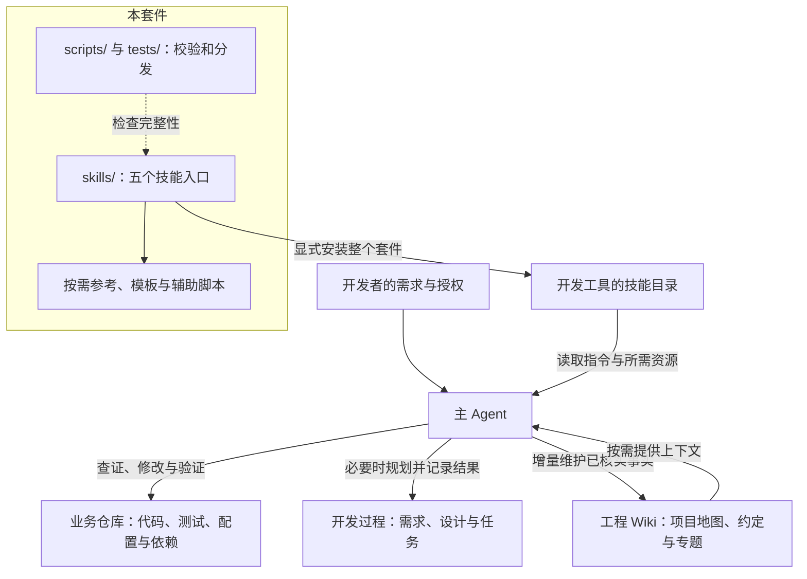
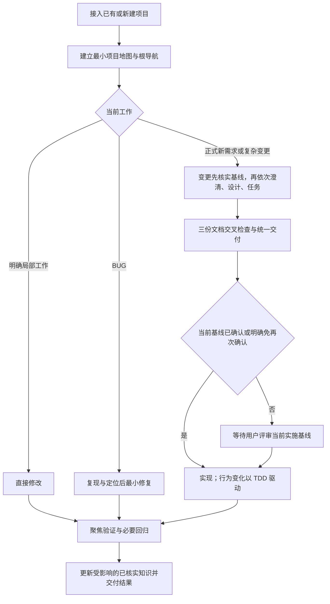
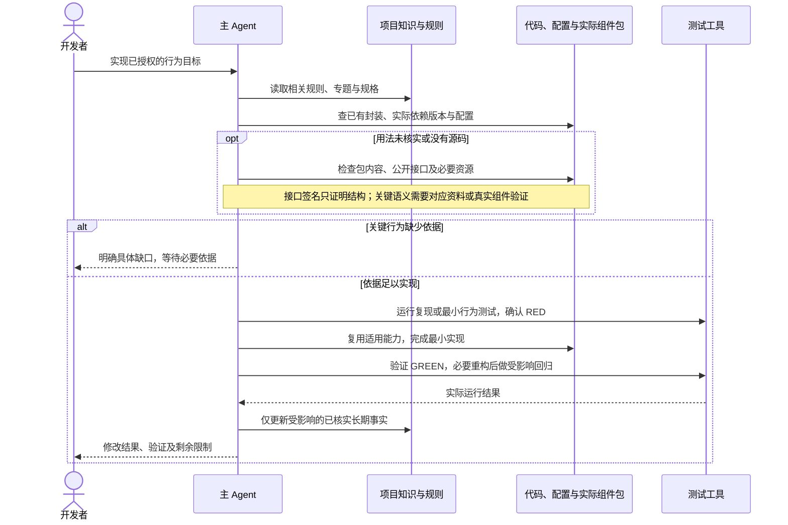

# Fons4AI Engineering

让 Agent 在已有工程中理解需求、复用能力、验证行为，并持续维护项目知识。适用于开发中的业务项目、新需求交付和已有功能迭代。

套件以五个技能组织工作：简单任务直接处理，复杂需求形成可评审的规格；知识与框架用法按需读取，减少重复规划和上下文加载。

## 五个技能

| 场景 | 技能 | 默认行为 |
| --- | --- | --- |
| 初始化、查询、更新、维护 Wiki 或提炼规则 | [项目知识管理](skills/fons4ai-knowledge/SKILL.md) | 一个生命周期入口，按操作加载 |
| 新需求或补充规划阶段 | [SDD 规划](skills/fons4ai-sdd-plan/SKILL.md) | 一次调用依次澄清、完整设计和精简任务，统一交付 |
| 调整已有功能 | [SDD 变更](skills/fons4ai-sdd-change/SKILL.md) | 先定位知识或过程基线，再决定修改方式 |
| 执行已授权工作 | [SDD 实现](skills/fons4ai-sdd-implement/SKILL.md) | 行为变化使用 TDD，聚焦验证，增量维护知识 |
| BUG、异常或回归 | [BUG 修复](skills/fons4ai-bugfix-workflow/SKILL.md) | 复现、最小修复、回归验证 |

简单局部任务直接处理，不强制生成文档。正式需求保留需求说明书、技术设计、任务规划：合并三次调用，不省略需求澄清或设计细节。默认三份文档完整交付后统一确认当前实施基线；认可总体思路或“用 SDD 开发”不自动批准后续细化规格。用户明确允许细化后直接实施时可免再次确认，同一已确认基线续做不重复询问。

简单行为调整也可走轻量流程，仍以 TDD 验证。仅补设计或任务时引用真实已有依据，不为模板补造其他阶段文档；跨技能转入变更前先核实基线。

## 整体架构



技能由主 Agent 读取并执行；参考与模板随套件分发，Python 工具负责确定性的检查和文件操作。业务项目保留自己的代码结构、技术栈与工程约定。资源边界见 [项目地图](docs/wiki/index.md)。

## 核心使用流程



项目知识可以逐步补充，接入时无需补写所有历史规格。业务工作遵循现有工程体系；实现与验证发现的新事实，再反馈到 Wiki。细节见 [SDD 与 Wiki 设计](docs/wiki/topics/sdd-and-wiki.md)。

## 关键交互时序

以下展示实现行为时，主 Agent 如何使用项目知识并核实仅以组件包提供的框架能力：



这是技能约定的执行顺序。组件清单工具只读取包条目和指纹；真实框架语义仍需资料或测试证明，详见 [框架与组件复用](docs/wiki/topics/dependency-reuse.md)。

## 快速开始

准备支持 Agent Skills 的开发工具。维护和分发本套件需要 Python 3.10 或更新版本，测试中的真实 JAR 用例在 JDK 工具可用时执行。

本套件五个技能一同分发，资源通过相邻技能链接复用。复制整个 `skills/` 下的五个目录到支持 Agent Skills 的工具目录，不单独复制 `SKILL.md`。调用前检查所需相邻技能可用；安装后重启或刷新工具的技能发现。

也可以从本仓库显式安装，下面的目标路径需要替换成当前工具实际使用的目录：

```sh
python scripts/sync_global_skills.py --target /path/to/skills
```

分发工具先验证，拒绝不完整套件和源/目标重叠，备份被替换的技能；旧版多余入口会被检测并阻止继续，按工具提示显式选择归档后重试。不会在日常开发中自动同步用户级技能。

旧版安装迁移使用 `--archive-obsolete`；备份位于目标目录同级的 `.fons4ai-backups/`，不会继续参与技能发现。

业务项目不需要复制整套 Kit 脚本。使用项目知识管理技能建立根目录 `README.md`、`AGENTS.md` 与 `docs/wiki/index.md`，已有文件合并保留人工内容。后续按任务需要建立专题和过程文档。

安装并刷新技能发现后，在目标业务仓库中可提出：

> 使用 fons4ai-knowledge 初始化本项目的工程 Wiki。先核查当前代码、测试、配置与依赖，合并根 README 和 AGENTS，建立项目地图与有依据的工程约定。只为当前需要的主题建页。

首次接入的可观察结果是根导航、项目地图和按事实生成的必要专题；不会为了初始化补写历史三件套。

## 验证与开发

```sh
# 当前套件、源码锁、导航和工具行为测试
python -B scripts/validate_all.py

# 对比用户级安装，只读检查
python scripts/sync_global_skills.py --target /path/to/skills --check-only
```

维护者审查技能修改后，用 `python scripts/sync_global_skills.py --write-lock` 更新源码哈希，再运行统一验证。当前工具测试覆盖包清单、导航、套件资源与安装保护；模型遵循率和真实 token 成本需要业务任务回放。

## 目录与文档导航

```text
README.md / AGENTS.md       根导航与工作规则
docs/wiki/                 当前项目地图、工程约定、按需专题
docs/development/          开发过程溯源
skills/                    五个可安装技能及按需资源
scripts/ / tests/          套件检查、分发和工具行为测试
templates/                 可选的维护者反馈模板
archive/v1/                原版技能、模板、文档快照，不参与发布
```

旧版 `.specify/`、Task Pack、交接 YAML、卡片编号和实施报告不再是当前流程要求。历史资料不自动迁移或删除。原有未跟踪的试点目录与旧校验包装脚本不属于当前发布入口。

- [项目地图](docs/wiki/index.md)：人和 Agent 共用的能力与文件入口。
- [工程约定](docs/wiki/工程约定.md)：维护本套件的规则。
- [SDD 与 Wiki 设计](docs/wiki/topics/sdd-and-wiki.md)：更完整的流程与设计取舍。
- [框架与组件复用](docs/wiki/topics/dependency-reuse.md)：无源码时的发现与证据边界。
- [Agent 指南](AGENTS.md)：项目身份、技能入口与工作规则。
- [开发过程](docs/development/index.md)：需求、设计、任务及验证记录。
