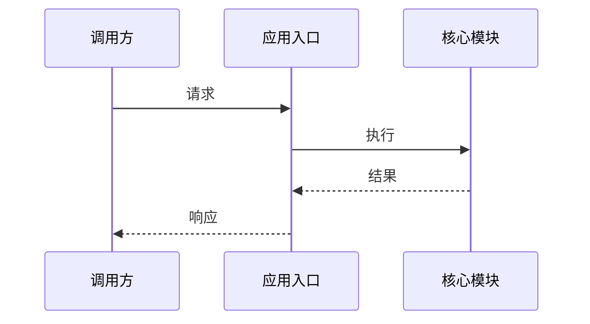

# <功能名称>技术设计说明书

> 功能标识：`<feature-slug>`
> SDD 等级：`S1 | S2`
> 来源需求：`<feature-dir>/<功能中文名>-需求说明书.md`
> 文档状态：初稿
> 设计确认状态：pending | approved | not-required
> 创建日期：YYYY-MM-DD
> 更新日期：YYYY-MM-DD
>
> **更新时间维护规则**：任何正文修改必须同步更新 `更新日期`，并在版本修订记录中追加说明。

## 1. 设计摘要与关键决策

- 功能目标：引用 REQ/AC，不重复需求背景。
- 设计范围：
- 非目标：
- SDD 等级理由：
- 交付画像：后端服务 / 前端应用 / CLI/批处理 / 库/SDK / 基础设施/IaC / 混合
- 独立可运行服务：是 / 否，原因
- 页面/交互型交付物：是 / 否，原因
- 数据结构变更：是 / 否，原因
- 规划建议：V1 单文件 | V2 Task Pack，原因

### 1.1 关键决策

| 决策 | 选择 | 原因 | 替代方案 | 影响 | 需用户确认 |
| --- | --- | --- | --- | --- | --- |
| D-001 | <选择> | <原因> | <方案及不采用原因> | <模块/契约/数据/风险> | 是/否 |

### 1.2 设计确认 Gate

- Gate 是否适用：否 | 是，原因
- 设计确认状态：pending | approved | not-required
- 用户需确认的关键点：无 | D-xxx
- 确认证据：无 | <用户消息摘要>

## 2. 系统边界、模块与调用链

### 2.1 模块与职责

| 模块/组件 | 职责 | 输入 | 输出 | 依赖 | 影响 AC |
| --- | --- | --- | --- | --- | --- |
| <模块> | <职责> | <输入> | <输出> | <依赖> | AC-001 |

### 2.2 调用链、服务形态与运行态设计

- 入口：
- 核心调用链：
- 外部依赖：
- 启动入口：不适用 | <命令/入口/部署单元>
- 配置来源：不适用 | <配置中心/环境变量/文件/密钥管理>
- 注册发现与路由：不适用 | <设计>
- 健康检查与核心运行验证：不适用 | <路径>



> 无复杂调用链时写：`不适用，原因`。

## 3. 接口、消息与外部契约

只记录新增或变更契约；完全复用且无变化时写 `不适用，原因`。

### 3.1 契约清单

| 契约 | 类型 | 标识/路径 | 鉴权 | 兼容策略 | 错误处理 | AC |
| --- | --- | --- | --- | --- | --- | --- |
| <名称> | HTTP/RPC/gRPC/消息/任务/UI | <标识> | <要求> | <策略> | <错误码/异常> | AC-001 |

### 3.2 详细契约

- 请求/输入：
- 响应/输出：
- 幂等：
- 超时/重试：
- 契约文件：无 | `contracts/<name>.md`

## 4. 核心业务、领域规则与状态流转

### 4.1 核心流程

- 触发条件：
- 输入：
- 处理步骤：
- 输出：
- 异常分支：
- 幂等要求：

```text
function handle(input):
  validate(input)
  executeBusinessRule()
  persistOrPublish()
  return result
```

### 4.2 规则落地

| 业务规则/行为 | 归属模块或对象 | 数据依赖 | 事务边界 | 扩展点 | 验证方式 |
| --- | --- | --- | --- | --- | --- |
| <规则> | <领域对象/应用服务/策略> | <依赖> | <边界> | <扩展点> | <验证> |

- DDD-lite 判断：
- 应用编排职责：
- 基础设施边界：
- 贫血模型例外：

### 4.3 状态流转

| 当前状态 | 触发动作 | 前置条件 | 目标状态 | 失败处理 | 幂等 |
| --- | --- | --- | --- | --- | --- |
| <状态> | <动作> | <条件> | <状态> | <处理> | <要求> |

> 无状态变化时写：`不适用，原因`。

## 5. 数据结构、迁移与初始化

### 5.1 数据影响判断

| 检查项 | 是否涉及 | 设计结论 |
| --- | --- | --- |
| 持久化数据或数据服务结构 | 是/否 | <结论> |
| 外部数据入库、出库、同步、对账或报表 | 是/否 | <结论> |
| 字段映射、金额、日期、状态、流水号或客户标识 | 是/否 | <结论> |
| 敏感数据、权限、脱敏、加密、审计或保留期限 | 是/否 | <结论> |
| 跨系统、跨服务、跨库或第三方数据流转 | 是/否 | <结论> |

### 5.2 字段映射与数据流

| 来源项 | 来源格式/单位 | 目标项 | 转换规则 | 空值/异常规则 | 安全要求 | 状态 |
| --- | --- | --- | --- | --- | --- | --- |
| <来源> | <格式> | <目标> | <转换> | <规则> | <要求> | 已确认/待确认 |

> 不涉及入库、同步、对账、报表、迁移或跨系统数据时写：`不适用，原因`。

### 5.3 结构变更详设

| 数据源/对象 | 变更类型 | 现状证据 | 目标状态 | AC | 风险 |
| --- | --- | --- | --- | --- | --- |
| <database/table/index/topic> | 新增/修改/删除/重命名 | <SQL/MCP/schema/待确认> | <摘要> | AC-xxx | 低/中/高 |

| 字段/属性 | 业务含义 | 目标类型 | 必填 | 默认值 | 主键/索引/约束 | 来源/写入方 | 迁移方式 | 安全级别 | 状态 |
| --- | --- | --- | --- | --- | --- | --- | --- | --- | --- |
| <name> | <含义> | <type> | 是/否 | <值> | <规则> | <来源> | <方式> | 普通/敏感/机密 | 已确认/待确认 |

- SQL 当前结构快照：无 | `.specify/sql/<database_or_service>/<business_model>.sql`
- 迁移位置：不适用 | <项目迁移目录/待确认>
- 执行型变更 DDL：不适用 | `<project-migration-path>.sql` | `<feature-dir>/ddl-changes/<INIT|CR-xxx>-<model>.sql`
- 回填/清理：不适用 | <策略>
- 回滚：不适用 | <策略>

> 不涉及结构变更时写：`不适用，原因`。设计阶段不生成可执行 SQL。

### 5.4 运行初始化 DML / Seed 数据

- 是否涉及：否 | 是
- 初始化对象：
- 脚本交付路径：不适用 | `<feature-dir>/dml-seed/<INIT|CR-xxx>-<model>.sql`
- 执行责任方：不适用 | 用户/DBA/部署流程/Agent 隔离环境
- 占位变量：无 | <变量>
- 幂等与回滚：
- 执行后复核：<只读查询、预期结果和证据保存位置>

### 5.5 数据安全与生命周期

| 检查项 | 设计结论 | 验证方式 |
| --- | --- | --- |
| 传输与存储安全 | 不适用，原因 | <验证> |
| 展示/日志脱敏 | 不适用，原因 | <验证> |
| 数据权限与审计 | 不适用，原因 | <验证> |
| 保留、删除与归档 | 不适用，原因 | <验证> |

## 6. 横切质量设计

| 主题 | 设计结论 | 验证方式 |
| --- | --- | --- |
| 异常与错误码 | <结论> | <验证> |
| 鉴权与应用安全 | <结论> | <验证> |
| 事务与一致性 | <结论> | <验证> |
| 并发、缓存与消息 | <结论> | <验证> |
| 性能与限流 | <结论> | <验证> |
| 兼容与迁移 | <结论> | <验证> |
| 日志、指标与追踪 | <结论> | <验证> |

## 7. AC、验证、风险与回滚

### 7.1 AC 设计矩阵

| REQ/AC | 设计落点 | 验证方式 | 风险 | 回滚/降级 |
| --- | --- | --- | --- | --- |
| REQ-001 / AC-001 | <模块/契约/规则> | <单测/集成/契约/手动> | <风险> | <方式> |

### 7.2 知识同步影响

- 是否需要知识同步：否 | 是
- 影响类型：业务规则 / 技术方案 / 数据结构 / 接口契约 / 治理规则
- 影响位置：无 | <知识文档或 SQL 快照>
- Knowledge Sync Needed: no | yes

## 附录 A. 证据清单

| 关键结论 | 证据来源 | 证据等级 | 状态 |
| --- | --- | --- | --- |
| <设计决策/契约/数据结构> | <需求/代码/接口/SQL/schema/用户确认> | L1/L2/L3 | 已验证/待确认/推断 |

## 附录 B. 版本修订记录

| 日期 | 版本 | 说明 |
| --- | --- | --- |
| YYYY-MM-DD | V1.0.0 | 初始化技术设计 |
