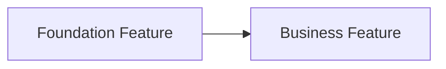

# <系统或大型需求名称> Initiative

> Initiative：`<initiative-slug>`
> 文档状态：draft | approved
> 创建日期：YYYY-MM-DD
> 更新日期：YYYY-MM-DD

## 1. 系统目标与边界

- 目标：
- 主要用户：
- 本期边界：
- 非目标：

## 2. Feature 地图

| Feature | 类型 | 独立验收结果 | DependsOn | 状态 | SDD 路径 |
| --- | --- | --- | --- | --- | --- |
| <feature-slug> | foundation/business/capability | <结果> | 无 | proposed | `spec/features/<yyyymmdd>/<feature-slug>/` |

## 3. 依赖与建议顺序

## 4. 架构原则

- <只记录跨 Feature 必须共享的原则，不展开子 Feature 技术设计>

## 5. 用户确认

- Feature 拆分确认状态：pending | approved
- 确认证据：无 | <用户消息摘要>
- 待确认：无 | <阻塞问题>
