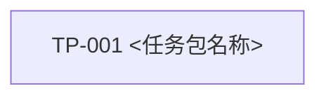

# <功能名称>任务索引

> 功能标识：`<feature-slug>`
> 规划模式：`task-pack`
> SDD 等级：`S1|S2`
> 来源需求：`<feature-dir>/<功能中文名>-需求说明书.md`
> 来源技术设计：`<feature-dir>/<功能中文名>-技术设计说明书.md`
> 当前活动任务包：无 | `TP-001`
> 实现确认状态：pending
> 创建日期：YYYY-MM-DD
> 更新日期：YYYY-MM-DD

## 1. 任务包地图

| TaskPack | 名称 | 目标 | AC | DependsOn | PackStatus | ApprovalStatus | 文件 |
| --- | --- | --- | --- | --- | --- | --- | --- |
| TP-001 | <任务包名称> | <可感知交付结果> | AC-001 | 无 | draft | pending | `tasks/TP-001-<任务包名称>.md` |

## 2. 实现确认门禁

- V2 中 `执行` 只执行“当前活动任务包”指向的已批准 Task Pack。
- 执行指定包：`执行 TP-001`。
- 执行指定任务：`执行 T001,T002`。
- 跨包执行必须明确回复：`执行全部活动任务包`。
- 任务索引或 Task Pack 的存在不等于实现授权。

## 3. 依赖与执行顺序

## 4. 状态摘要

- 活动任务包：无 | TP-xxx
- 阻塞任务包：无 | TP-xxx，原因
- 延期任务包：无 | TP-xxx，责任方和恢复条件
- 已完成任务包：无 | TP-xxx
- 已替代/归档任务包：无 | TP-xxx，替代来源
- 当前变更：无 | CR-xxx

## 5. AC 覆盖

| AC | 覆盖 TaskPack | 状态 |
| --- | --- | --- |
| AC-001 | TP-001 | planned |

## 6. 拆分决定

- 使用 Task Pack 的原因：
- 是否应进一步拆成独立 Feature：否 | 是，原因
- 用户确认：pending | approved，证据摘要
